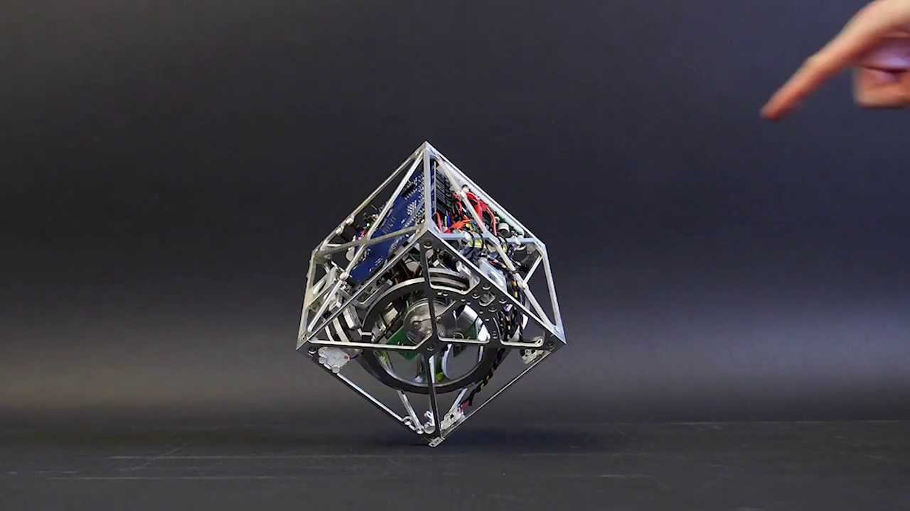

<h1 align="center">self-balancing-cube</h1>

  

  Inspiration: <a href="https://idsc.ethz.ch/research-dandrea/research-projects/archive/cubli.html">Cubli</a>, ETH Zurich (IDSC). Photo is theirs, used here as a reference only.

  A cube that balances on one corner with three reaction wheels, controlled by an RL policy.

  <b>Status:</b> not started. Begins after the reaction wheel inverted pendulum
  is built and balancing on real hardware.

